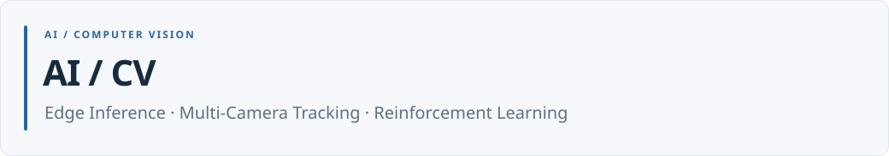

<picture>
  <source media="(prefers-color-scheme: dark)" srcset="./assets/readme/header-dark.svg">
  
</picture>

Jetson의 영상 추론·다중 카메라 연동과 DQN 기반 창고 배치 시뮬레이션을 구현한 프로젝트입니다.

[프로젝트 목록](#프로젝트) · [웹 포트폴리오 ↗](https://seungyeol-rtl-portfolio.azuretide33.chatgpt.site)

## 프로젝트

| 프로젝트 | 담당 역할 | 주요 구현·결과 |
|---|---|---|
| [Multi-Camera Re-ID Tracking](./AI/multicam-cctv-reid) | OSNet 추론 인터페이스·MQTT/Camera A·B 초기 구현·검증 스크립트 | 카메라 간 동일인 연결·경로 판단, Jetson 실행 환경과 이동 시간 조건 점검 |
| [Jetson AI Rock–Paper–Scissors](./AI/jetson-rps-game) | TensorRT 손 영상 분류·4모드 웹 게임 연동 | 실시간 입력·승패·UI 연결, 소스·엔진·UI 자산 자동 검사 |
| [DQN 기반 물류창고 배치 시뮬레이션](./AI/warehouse-dqn) | 개인 프로젝트 · 전처리·창고 환경·보상·DQN·시각화 | 동일 조건 정책 비교, 환경·학습·출력 생성 자동 시험 7개 PASS |

[CI 실행 기록](https://github.com/lsy49055089/AI-Projects/actions/workflows/portfolio-ci.yml)

---

[웹 포트폴리오](https://seungyeol-rtl-portfolio.azuretide33.chatgpt.site) · [GitHub 프로필](https://github.com/lsy49055089)

[논문](https://github.com/lsy49055089/Parallel-Decision-Tree-Hardware) · [RTL / FPGA Design](https://github.com/lsy49055089/RTL-Design-Projects) · [Design Verification](https://github.com/lsy49055089/RTL-Verification-Projects) · [Embedded Systems](https://github.com/lsy49055089/Embedded-Systems-Projects) · [AI / CV](https://github.com/lsy49055089/AI-Projects)
